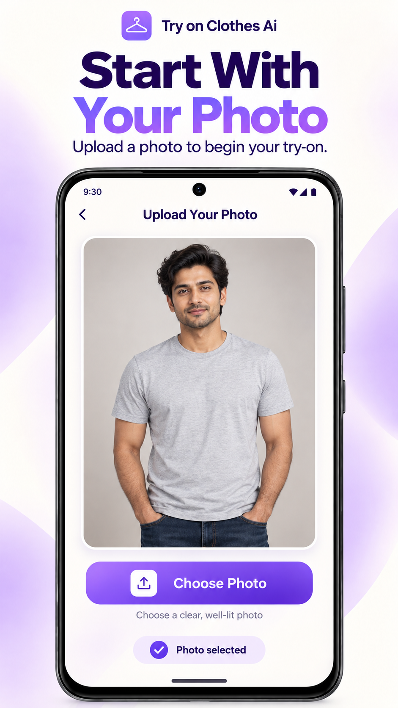
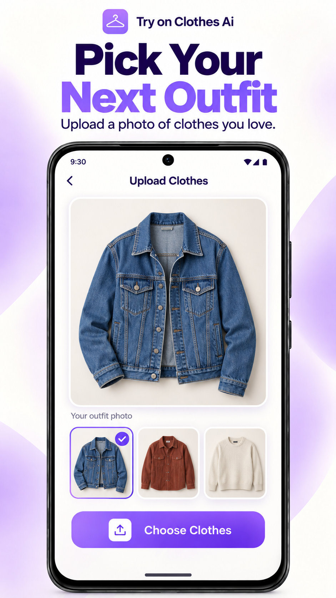
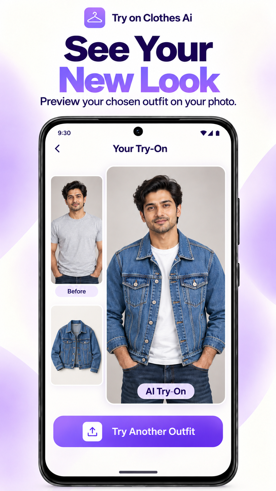
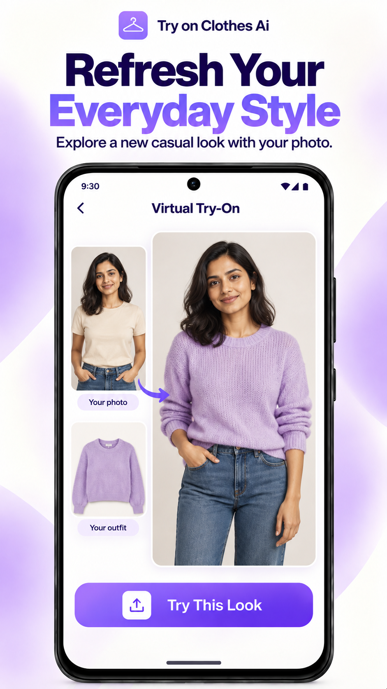
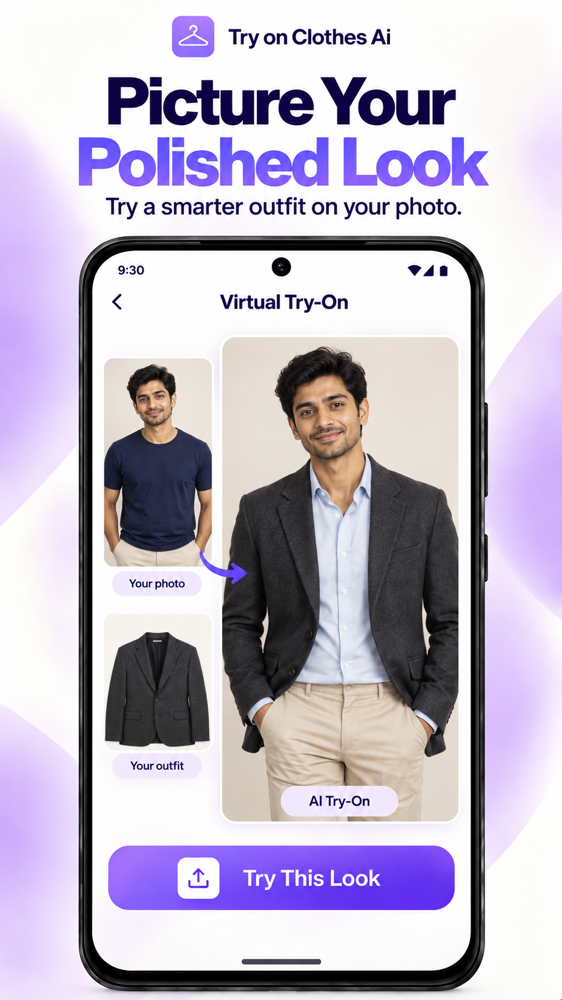
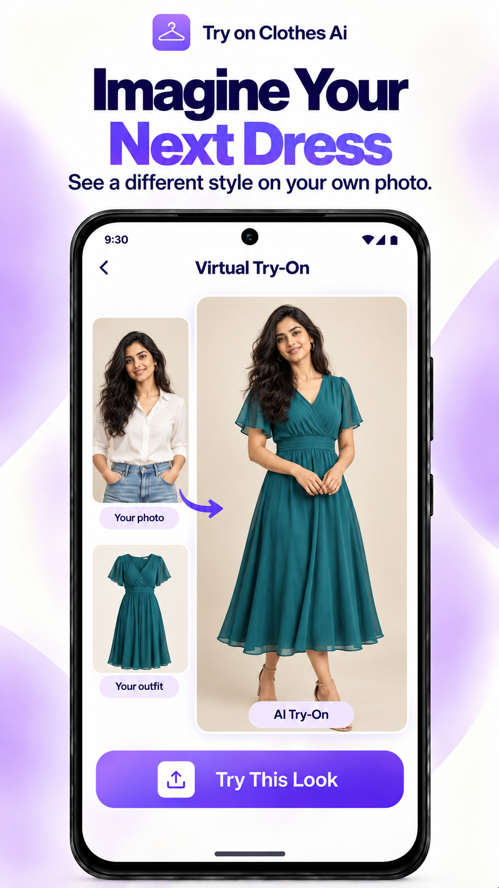
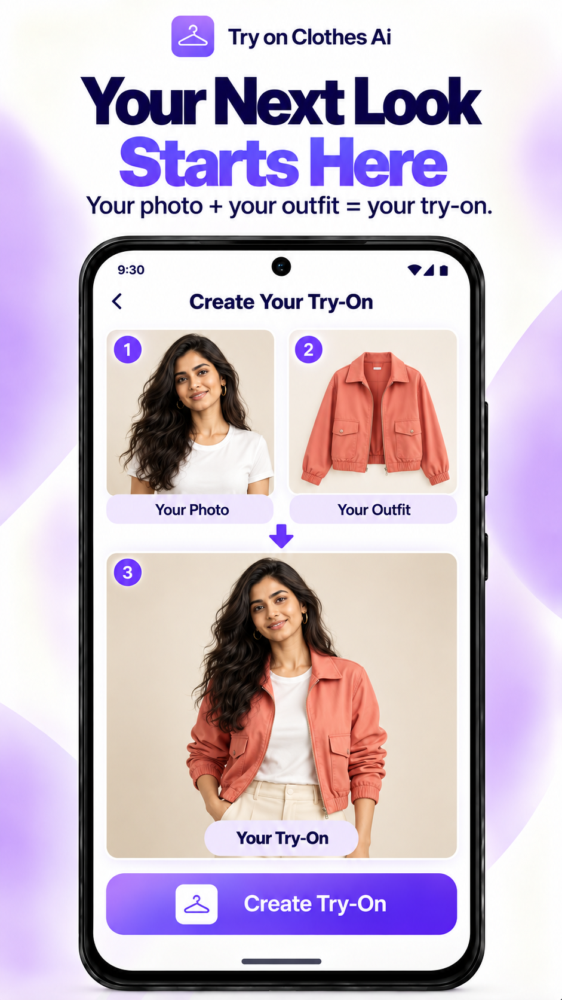
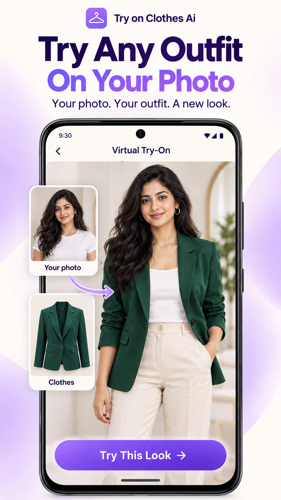

# 👗 Try On Clothes AI - Virtual Fitting Room

[](https://flutter.dev)
[](https://dart.dev)
[](https://www.android.com)
[](LICENSE)

An intelligent, production-ready AI Virtual Try-On mobile application built with **Flutter**, **Riverpod**, and state-of-the-art Generative AI models. Try on any shirt, dress, jacket, or outfit virtually on your own photo with realistic garment drape and complete facial preservation.

---

## 📱 App Demo & Screenshots

<p align="center">
  
  
  
  
</p>
<p align="center">
  
  
  
  
</p>

---

## ✨ Key Features

* **🎭 Precision Identity Lock Engine**: Proprietary mathematical cosine alpha-blending that guarantees 100% original preservation of the user's face, hair, and upper neck—preventing artificial or distorted faces.
* **📐 Smart Framing Coordinator**: Automatically detects person framing (half-body, full-body) and garment category (upper-body, lower-body, dresses) to ensure proper sizing and alignment.
* **🌐 Multi-Provider AI Architecture**:
  * **Hugging Face Spaces** (IDM-VTON / ZeroGPU Gradio 4.x queue protocol)
  * **Replicate** (IDM-VTON, OOTDiffusion)
  * **Fal.ai & Segmind**
  * **OpenAI** (DALL-E 3 image generation & vision analysis)
  * **Bring-Your-Own-Key (BYOK)**: Users can enter their own API keys in Settings.
* **🪙 Coins & Monetization System**:
  * AdMob integration with smart frequency capping (Interstitial on every 2nd generation).
  * Rewarded ads to earn free try-on coins.
  * In-App Purchase (IAP) coin bundle packs.
* **🔄 Google Play In-App Updates**: Built-in support for flexible and immediate in-app updates using the Google Play In-App Update API.
* **🛡️ Hardened Security**: Native C++ JNI bridge for secret obfuscation and secure BYOK (Bring-Your-Own-Key) credential isolation.

---

## 🏗️ Architecture

The app is built using **Clean Layered Architecture** with strict separation of concerns:

```text
lib/
├── core/
│   ├── config/          # App constants, theme tokens, ad unit IDs
│   ├── di/              # Riverpod dependency injection container
│   ├── providers/       # Global reactive state providers
│   └── services/        # AI engines, Identity Lock, AdMob, IAP, NativeKey
├── features/
│   ├── home/            # Dashboard, category browser, preset models
│   ├── try_on/          # Photo upload, camera capture, real-time generation UI
│   ├── result/          # Side-by-side comparison slider, HD export & share
│   ├── history/         # Local SQLite/Hive history of generated try-ons
│   ├── shop/            # Coin store & subscription plans
│   └── settings/        # API key management, provider picker, theme toggle
└── shared/
    ├── models/          # Data transfer objects & immutable state models
    └── widgets/         # Glassmorphism cards, animated buttons, modal sheets
```

---

## 🚀 Getting Started

### 1. Prerequisites
* [Flutter SDK](https://docs.flutter.dev/get-started/install) (>= 3.22.0)
* [Android Studio](https://developer.android.com/studio) with Android SDK and NDK installed
* JDK 17+

### 2. Clone the Repository
```bash
git clone https://github.com/OPSHARP/try-on-clothes-ai.git
cd try-on-clothes-ai
```

### 3. Install Dependencies
```bash
flutter pub get
```

### 4. Keystore Setup (For Release Builds)
1. Copy the example properties file:
   ```bash
   cp key.properties.example key.properties
   ```
2. Generate your upload keystore:
   ```powershell
   ./scripts/generate-release-keystore.ps1
   ```
   Or place your existing `upload-keystore.jks` in the `android/` directory and configure credentials inside `key.properties`.

---

## 🧪 Running Tests & Diagnostics

To run the full test suite verifying AI pipelines, identity locks, and UI flows:

```bash
flutter test
```

To run static analysis:
```bash
dart analyze lib
```

---

## 📱 Building the App

### Debug Mode (Emulator / Physical Device)
```bash
flutter run
```

### Production Release APK
```bash
flutter build apk --release
```
Output: `build/app/outputs/flutter-apk/app-release.apk`

### Production Release App Bundle (Google Play Store)
```bash
flutter build appbundle --release
```
Output: `build/app/outputs/bundle/release/app-release.aab`

---

## 🔒 Security Best Practices

* **No Hardcoded Secrets**: All live API tokens, keystores, and signing properties are excluded via `.gitignore`.
* **Zero-Leak BYOK Architecture**: API tokens can be entered securely by users in Settings without storing or leaking keys in the codebase.
* **ProGuard & R8 Obfuscation**: Android release builds are minified, obfuscated, and resource-shrunk.

---

## 📄 License

This project is licensed under the MIT License - see the [LICENSE](LICENSE) file for details.
